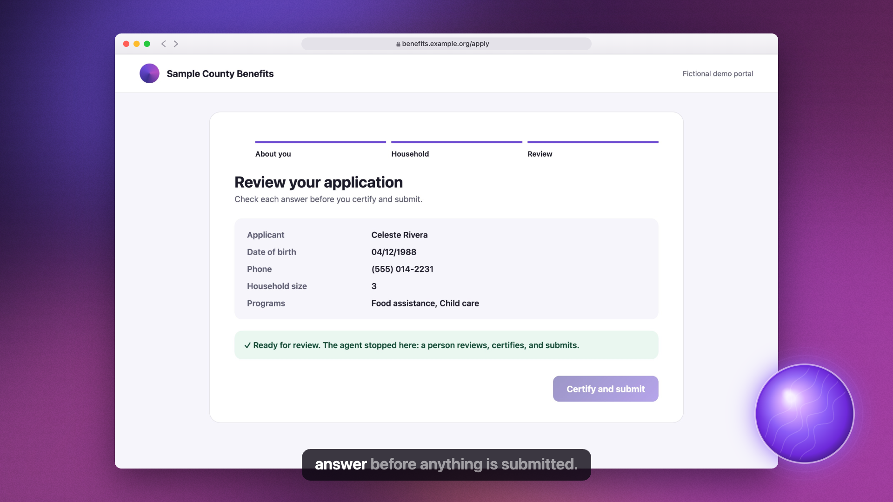
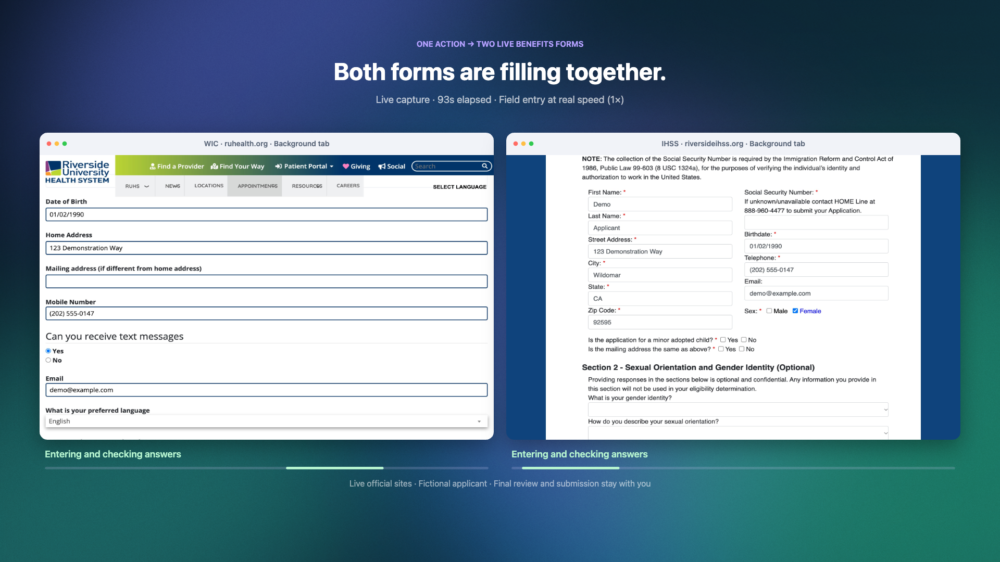
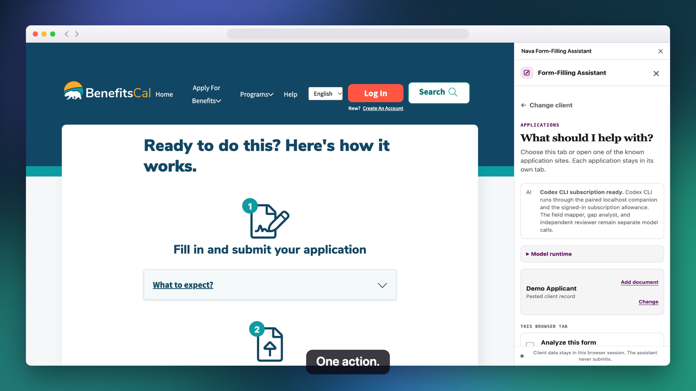
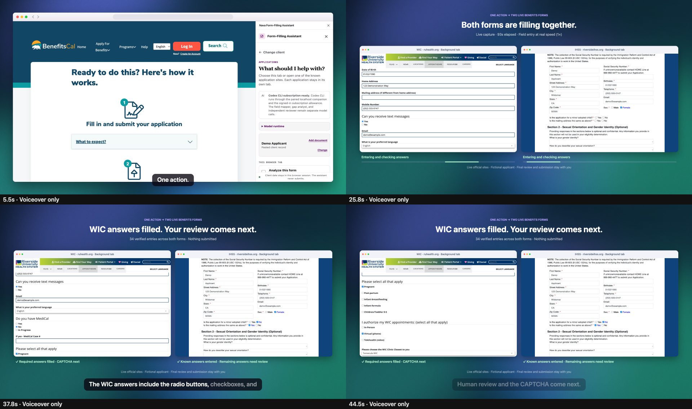
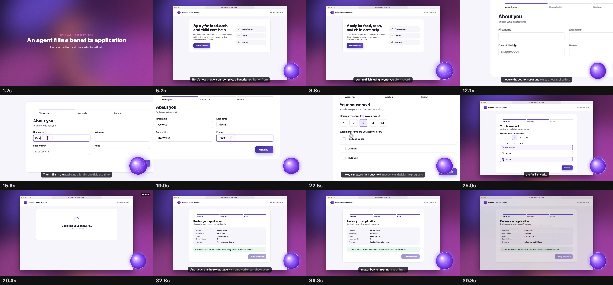

# Nava Presentation Studio

Version 0.4 combines the Nava presentation toolkit and product demo studio in
one local workflow: shape the story, generate editable slides, record or reuse
product demos, and package the presentation for sharing. A single manifest
builds a PowerPoint with embedded videos, a browser presentation, a reading PDF
and a portable ZIP. Text and tables stay editable; recordings keep their
original timing. The existing `demo-studio` commands still work.

This is an experimental local authoring tool, primarily tested on macOS with
Google Chrome. It is intended for trusted scripts and projects, using synthetic
demo data. See [known limits](#known-limits) and [security guidance](SECURITY.md).

The recorder, slide generator and exporter are MIT licensed. No Screen Studio
license, paid video service or model API is required to build or present.
Studio has no recording-upload service. Package installation, model downloads,
an authoring agent and the product being demonstrated can use the network or
require their own accounts.

New teammates can start with [the team quick start](docs/TEAM_QUICKSTART.md).
For tightening an existing recording, see [editing waits and parallel work](docs/EDITING.md).

## First presentation

Requires Node 20.9+ and Google Chrome.

```sh
git clone https://github.com/navapbc/nava-agentic-demo-studio.git
cd nava-agentic-demo-studio
npm ci
npm run doctor
npm run presentation
node bin/presentation-studio.mjs serve exports/presentation
```

Paste `http://127.0.0.1:4311/index.html` into Chrome's address bar. The local
server blocks cross-site navigation, so clicking a localhost link on GitHub can
be blocked. You can also unzip `presentation.zip` and open `index.html` in Chrome.
The bundled example records a fictional benefits portal.
For your own project, copy [the presentation manifest](examples/presentation-system.presentation.json)
and replace its demo with a recording script or existing MP4:

```sh
node bin/presentation-studio.mjs build path/to/presentation.json --out exports/my-presentation
```

See [the presentation system guide](docs/PRESENTATION_SYSTEM.md) for authoring,
formats and playback limits. The PDF shows video posters. Studio does not export
the entire deck as one narrated movie.

The first narrated build downloads the Kokoro model. If that download or the
optional speech dependency is unavailable, set `"voice": { "provider": "none" }`
in `examples/benefits-portal.script.json` before building; captions still work.
For the macOS speech fallback, use `"provider": "say"`. `doctor` checks Chrome
and codecs; it does not download or test the Kokoro model.

## Install the combined Codex plugin

The optional plugin packages Nava storycraft, the story-plan auditor and the
Studio workflow. With a Codex CLI that supports plugins, install it from the
Nava repository:

```sh
codex plugin marketplace add navapbc/nava-agentic-demo-studio --ref v0.4.1
codex plugin add nava-presentation-studio@nava-presentation-studio
```

The plugin provides instructions; the cloned repository and `npm ci` supply its
local recording and build runtime. It is not required to run either CLI. See
[OpenAI's plugin setup documentation](https://developers.openai.com/plugins/build/plugins)
for marketplace setup. Existing presentation templates remain authoritative.
The starter theme is a Studio theme.

## Choose your video style

In the preview, turn **Show voice orb** on or off. Voiceover, music and captions
continue either way, and **Export MP4** uses your selected setting.

**Purple orb:** a voice presence that responds to the narration.



**Voiceover only:** the browser extension and product stay in view without an
orb overlay. This example shows WIC and IHSS applications side by side, using
fictional applicant data. These views use the existing two-application recording
with the orb hidden.



<details>
<summary>More frames from both styles</summary>







</details>

## What you get

| Screen Studio-style feature | How it works here |
| --- | --- |
| Auto zoom where you click or type | Zoom depth adapts to the target (small buttons get a closer look than wide form rows). Camera moves use a monotone spline, so chained pans glide through targets instead of stopping at each one |
| Camera follows the cursor | While zoomed, the view keeps the pointer inside a comfort margin |
| Motion blur | Fast pans, zooms, and cursor moves are rendered with a 180° shutter (up to 10 sub-frames) |
| Smooth cursor with real shapes | Cursor redrawn from recorded paths: an arrow, a hand over clickable elements, and an I-beam over text fields. It hides when idle and returns just before the next move |
| Click effects and sounds | Ripples plus a two-part mechanical click (press and release), panned to where the click happens, and soft keyboard ticks while typing |
| Speed up slow parts | Idle spans (loading, waiting) are fast-forwarded with ramped speed changes and a fast-forward badge. Narration and actions always play at 1× |
| Cut dead time | `speed.cuts` removes source-time ranges entirely. Voice, captions, camera and all captured tabs follow one shared edit map; cuts that overlap narration or recorded actions are rejected |
| Background and window | Mesh-gradient wallpapers (`nava`, `aurora`, `sunset`, `ocean`, `midnight`, `paper`) with film grain against banding, and a macOS browser window with traffic lights and a URL bar |
| Title and closing cards | `intro` / `outro` cards in the script |
| AI voiceover | Kokoro-82M runs locally after a model download. macOS `say` and captions-only output are alternatives. The recorder paces the actions to the narration |
| Background music | Five generated styles (`upbeat`, `synthwave`, `lofi`, `ambient`, `warm-pop`) with an arrangement that follows the demo and ducks under narration. Or supply a track you have permission to use with `music.file`; it is looped and loudness-matched |
| Optional purple voice orb | Turn **Show voice orb** on or off in the preview. A code-rendered orb responds to narration; no image asset is required. Exports use your selection |
| Voice-only video | Turn the orb off, pass `--orb off`, or set `presenter` to `false` in the script. Voiceover, music and captions continue |
| Subtitles | Timed captions that highlight each word as it is spoken |
| Record real windows | ScreenCaptureKit capture of any window or display, including browser chrome and extension side panels, with a recorded pointer log driving zoom and cursor |
| Export | Frame-by-frame WebCodecs render to H.264/AAC MP4 at 1080p or 4K, 30 or 60 fps, when the installed Chrome supports those encoders |

## Quick start

Requires Node 20.9+ and Google Chrome. From a clone of this repository:

```bash
npm ci
npm run doctor
npm run make
```

`npm run make` records the bundled fictional benefits-portal fixture and writes
`exports/benefits-portal.mp4`. The example explicitly requests the optional
`kokoro-js` voice; its first run downloads a model into
`~/.cache/nava-demo-studio/models`. For an offline or captions-only run, change
the example's voice provider to `none`. Build time depends on the machine,
model cache and output settings. Review a contact sheet:

```bash
node bin/demo-studio.mjs inspect exports/benefits-portal.mp4
```

Or scrub it interactively:

```bash
npm run serve
```

Paste `http://127.0.0.1:4310/web/?project=/recordings/benefits-portal/project.json`
into Chrome's address bar.

## Making a demo (for agents)

1. Write a script. Every step can carry a `say` line; the recorder waits for the
   line to finish unless the step sets `"waitForSpeech": false`.

   ```json
   {
     "schema": "nava.demo-script.v1",
     "title": "An agent fills a benefits application",
     "startUrl": "examples/fixtures/benefits-portal/index.html",
     "voice": { "provider": "kokoro", "voice": "af_heart" },
     "presenter": { "kind": "orb", "color": "#8b5cf6" },
     "frame": { "kind": "browser", "url": "benefits.example.org/apply" },
     "intro": { "eyebrow": "Nava Labs", "title": "An agent fills a benefits application" },
     "steps": [
       { "do": "click", "target": "#start", "label": "Start application", "say": "It starts a new application." },
       { "do": "type", "target": { "label": "First name" }, "text": "Celeste", "label": "Enter first name" },
       { "do": "wait", "for": "#review h2", "label": "Checking answers" },
       { "do": "hover", "target": "#ready", "say": "And it stops before anything is submitted." }
     ]
   }
   ```

2. Run `node bin/demo-studio.mjs make path/to/script.json`.
3. Run `inspect` on the MP4 and look at the contact sheet before sharing it
   (`--at 12.5,20` grabs full-size frames at specific seconds).

See [examples/benefits-portal.script.json](examples/benefits-portal.script.json)
for a complete script.

### Steps

| `do` | Required | Optional | Notes |
| --- | --- | --- | --- |
| `goto` | `url` | | Relative URLs are served from this repository |
| `click` | `target` | `at` | `at` is where to click inside the element, `{ "x": 0-1, "y": 0-1 }` |
| `type` | `target`, `text` | `delayMs`, `clear` | `text` is typed but never written to the trace |
| `select` | `target`, `value` | | Native select popups do not render in headless capture |
| `hover` | `target` | | |
| `scroll` | `to`, `y`, or `by` | | Smooth scroll |
| `wait` | `ms` or `for` | `timeoutMs`, `until: "filled"` | Waits are the spans that get fast-forwarded; `until` waits for an agent to fill the field |
| `focus` | `target` | | Holds the camera on a region without moving the pointer |
| `pause` | | `ms` | A deliberate hold at 1× |
| `milestone` | `label` | | |

Every step also accepts `label`, `say`, `leadMs`, `holdMs`, `waitForSpeech`, and `in` (`page` or `sidepanel`). A script's `setup` list takes the same steps (without `say`) and runs them before recording starts.
A `target` is a CSS/Playwright selector string, or `{ "text" }`, `{ "label" }`,
`{ "placeholder" }`, `{ "testId" }`, or `{ "role", "name" }`.

Script-level options:

- `viewport` and `deviceScaleFactor` (default 2, for retina capture).
- `voice`: `provider` is `auto`, `kokoro`, `say`, or `none`. `voice` is a Kokoro
  voice such as `af_heart`, `af_bella`, `am_michael`, or `bf_emma`, or a `say`
  voice. Also `speed` (Kokoro) and `rate` (`say`). For published demos, prefer
  Kokoro and tune `speed` to the script and footage; macOS `say` is kept as an
  availability fallback and will sound noticeably more synthetic.
- `frame`: `{ "kind": "browser" | "none", "url": "…" }`, or `false`.
- `browser` (window and screen recorders): `{ "profile": "nano", "onDeviceAI": true }`.
  `profile` keeps a named Chrome profile in `~/.cache/nava-demo-studio/chrome-profiles/`
  between runs. `onDeviceAI` enables Chrome's built-in Gemini Nano, which
  downloads once into that profile. The window recorder follows web tabs the
  page or an extension opens, so a site an extension launches is recorded
  too.
- `music`: `{ "style": "upbeat" | "synthwave" | "lofi" | "ambient" | "warm-pop", "volume": 0.6 }`,
  `{ "file": "assets/music/track.mp3", "volume", "startAtS", "loop" }`, or
  `false`. Preview the styles with `node bin/demo-studio.mjs music`.
- `presenter`: `{ "kind": "orb", "color": "#8b5cf6" }` for the animated
  purple voice orb, or `false` for voice-only video. `intro` and `outro`
  configure opening and closing cards.
- `zoom`: `minScale`, `maxScale`, `targetShare`, `sessionGapMs`, and more.
  `introMs` and `outroMs` control the duration of the opening and closing cards.
  `speed.cuts` accepts ordered `{ "startMs", "endMs" }` ranges in source milliseconds.
  `captureParallel: true` records background tabs on one clock; author
  `parallel-start` / `parallel-end` milestones and preserve active work with
  `pause` events in the recorded trace before planning.
- `speed`: `minIdleMs`, `maxRate`.
- `output`: `width`, `height`, `fps`, `bitrate`, `motionBlur`.
- `style`: `background` (a wallpaper name or a list of colors), `accent`,
  `padding`, `radius`.

## Recording extensions and real windows

There are three recorders. Pick one with `"recorder"` in the script:

| Recorder | What it captures | Needs |
| --- | --- | --- |
| `page` (default) | The web page, headless | Google Chrome; no Screen Recording permission |
| `window` | A real Chrome window: the page plus an extension's side panel, each captured with the DevTools screencast and composited back into one window with drawn browser chrome | Google Chrome and the unpacked extension; no Screen Recording permission |
| `screen` | The true pixels of any window or display (real browser chrome, native apps) with ScreenCaptureKit | macOS 13+, Xcode Command Line Tools, Screen Recording permission and an unlocked display |

For an extension demo an agent records on its own, use `window`. Add
`"extensions": ["path/to/unpacked"]` and `"sidePanel": true`, and target the
panel with `"in": "sidepanel"`. `setup` steps run before capture starts, for
example to pair a model runtime. A typed value can come from the environment
(`"text": { "env": "NAVA_MODEL_BRIDGE_TOKEN" }`), keeping it out of the script
and trace. It can still appear in captured pixels: enter secrets only in masked
controls during `setup`, before capture, and inspect the recording before sharing.
`{ "do": "focus", "target": "#form" }` points the camera
at something an agent is filling on its own. `{ "do": "wait", "for": "#phone", "until": "filled" }`
waits for that agent to finish. See
[examples/form-filler-extension.script.json](examples/form-filler-extension.script.json),
which records the Nava Form-Filling Assistant filling a form with Claude
through its subscription companion.

Extension examples are integration templates, rather than self-contained first
runs. They require a separate unpacked extension, its running local model
companion and a pairing token. Update the extension path, endpoint and UI
selectors for the version you have installed. None of those components is
needed for the bundled benefits-portal example.

### Screen recording (real windows, native apps)

The page recorder sees only the web page. The screen recorder captures a real
window with ScreenCaptureKit, including browser tabs and toolbar, extension
side panels, and any native app. A small Swift helper
(`native/demo-capture.swift`, built automatically the first time with
`swiftc`) captures at retina resolution with the system cursor hidden, and
writes the same frame format the renderer already uses. It also logs cursor
position, clicks, and cursor shape (never keystrokes), so auto-zoom, the drawn
cursor, and click effects work on any recording.

macOS asks for **Screen Recording** permission once, for the app that runs the
command (Terminal, or Claude or Codex for an agent). Run `node bin/demo-studio.mjs screen access`,
approve it in System Settings > Privacy & Security > Screen & System Audio
Recording, then quit and reopen that app.

Two ways to use it:

1. **Record whatever a person or a computer-use agent does:**

   ```bash
   node bin/demo-studio.mjs screen list
   node bin/demo-studio.mjs screen record --app "Google Chrome" --seconds 45 --name my-demo --caption "My demo"
   ```

   It stops after `--seconds` (or on Ctrl-C), then plans and renders
   `exports/my-demo.mp4` with zooms driven by the recorded clicks.

2. **Scripted, with a real browser window:** set `"recorder": "screen"` in a
   script. It works like `window` but captures true pixels, so the display must
   be unlocked and the recorded window is brought to the front. Check a script
   without recording it by running `node bin/demo-studio.mjs record SCRIPT.json --dry-run`.

While a scripted screen recording runs, keep your own mouse off the recorded
window: real mouse events still reach it.

## Commands

| Command | What it does |
| --- | --- |
| `make SCRIPT [--out OUT.mp4] [--4k] [--fps 30] [--headed]` | voice, record, plan, render |
| `voice SCRIPT` | Synthesize narration only |
| `record SCRIPT [--headed]` | Voice + record + plan, no render |
| `plan TRACE PROJECT [--voice MANIFEST] [--script SCRIPT]` | Trace to project (edit decision list) |
| `render PROJECT [OUT.mp4]` | Headless MP4 render of a project |
| `inspect VIDEO [SHEET.png] [--at s,s]` | Contact sheet or full-size frames |
| `rig RIG.json [OUT.png]` | Preview an explicitly configured local portrait rig |
| `music [--style NAME\|all\|list] [--seconds 30]` | Render music auditions (M4A/WAV), spectrograms, and levels |
| `screen access` | Request macOS Screen Recording permission |
| `screen list [--json]` | Windows and displays you can record |
| `screen record [--app NAME \| --window ID \| --display ID] [--seconds N] [--name SLUG] [--caption TITLE]` | Record a window a person or agent drives, then render it |
| `record SCRIPT --dry-run` | Run a script's steps without capturing, to check them |
| `serve [PORT]` | Preview UI |
| `doctor` | Check Chrome, H.264/AAC encoding, and voices |

## Architecture

```text
script.json --voice--> recordings/<slug>/voice/*.wav + manifest.json
            --record-> recordings/<slug>/frames/*.jpg + frames.json + trace.json
            --plan---> recordings/<slug>/project.json
            --render-> exports/<slug>.mp4
```

- `lib/recorder.mjs` drives headless Chrome through the script and captures
  damage-driven retina frames with the DevTools screencast.
- `lib/planner.mjs` turns the trace into speed spans, camera keyframes, cursor
  paths, subtitles, voice placement, click effects, and presenter swaps.
- `lib/timeline.mjs` holds the pure timing and framing math shared by Node and
  the browser.
- `web/compositor.js` draws a frame as a pure function of output time;
  `web/audio.js` renders the mix offline; `web/render.js` encodes with
  WebCodecs and muxes with `mp4-muxer`. The preview and the export use the same
  code, so what you scrub is what you ship.

## Privacy contract

A trace may contain only timestamps, normalized pointer coordinates, event
kinds, redacted step labels, and script-authored narration. `validateTrace`
rejects fields outside that schema, and the e2e test (`npm run e2e`) checks a
real recording for its typed test strings. This is not automatic redaction of
free text: keep labels and narration free of secrets. Scripts must use synthetic
demo data because entered values, page content and URLs can be visible in the
recording. A remote website or extension may receive entered data even though
Studio has no recording-upload service. Inspect scripts, traces and the final
media before sharing.

## Voice presence

Use **Show voice orb** in the preview to show or hide the orb. The choice applies
to the current preview and its MP4 export. It keeps your place in the video and
does not interrupt the voiceover. Reopening a project uses its saved settings.

For a repeatable build, choose the orb in your script:

```json
"presenter": { "kind": "orb", "color": "#8b5cf6" }
```

For narration over the product video with no overlay, use:

```json
"presenter": false
```

You can also choose at the command line without editing the script:

```sh
node bin/demo-studio.mjs make examples/benefits-portal.script.json --orb off
node bin/demo-studio.mjs render recordings/benefits-portal/project.json exports/benefits-portal-orb.mp4 --orb on
```

`--orb on|off` works with `make`, `record`, `plan`, `render` and `screen record`.
It overrides the saved visual choice for that command. Rendering an existing
project changes the orb without recording again or retiming the video.
The control changes Studio's overlay. To change an orb already baked into an
MP4, reopen the original Studio project.

Both options keep voiceover, music and captions. The orb requires no image asset.
Legacy portrait rigs remain available for explicit local experiments with
`presenter.kind: "portrait"`, an `image` and a `rig`; they are outside the shared
demo workflow. Use only fictional likenesses.

## Known limits

- Studio runs trusted local scripts, projects and web pages; it is not a
  sandbox for untrusted input or a hosted multi-user service. Keep its preview
  servers on loopback and stop them when finished. See [SECURITY.md](SECURITY.md).
- macOS is the primary tested platform. Page capture and rendering use Chrome;
  native screen capture is macOS-only. Other operating systems need separate
  compatibility validation, including speech and H.264/AAC support.
- The screen recorder needs macOS 13 or newer, the Xcode Command Line Tools
  (for `swiftc`), Screen Recording permission, and an unlocked display: macOS
  draws no windows while the screen is locked, and Chrome stops painting a
  covered window. The `window` recorder has neither limit. Scripted side
  panels need an extension that declares `side_panel`.
- Extensions load into real Google Chrome over DevTools
  (`--enable-unsafe-extension-debugging` plus `Extensions.loadUnpacked`),
  because Chrome 137+ ignores `--load-extension`. Set
  `"browser": { "engine": "testing" }` to use Chrome for Testing instead.
  Chrome for Testing has no working component updater, so Gemini Nano only
  works in the Chrome engine.
- On-device AI needs a compatible Chrome installation and device. With
  `"browser": { "profile": "chrome-nano", "onDeviceAI": true }`, any model
  download belongs to that named profile; it does not reuse your everyday
  Chrome profile. The flag requests the browser feature rather than guaranteeing
  model availability. Allow time and disk space for the browser's download.
- Kokoro has no word timings, so caption word timings are estimated. Review
  caption pacing with the exported narration before sharing.
- Legacy `rawVideo` projects (a `.mov`/`.mp4` plus a hand-written trace) still
  plan and render, but seeking a long H.264 file per frame is slow.

## Tests

```bash
npm test
npm run e2e
```

`npm test` runs the unit tests and needs no browser. `npm run e2e` records and
renders a short demo, builds a presentation and checks embedded media and
browser playback; it needs Chrome.

## Contributing and credits

See [CONTRIBUTING.md](CONTRIBUTING.md) for development checks and media review.
The Studio source is licensed under [MIT](LICENSE). The copied Nava presentation
guidance and its source revision are recorded in
[SOURCE_PROVENANCE.json](SOURCE_PROVENANCE.json). Installed libraries and
downloaded speech models have their own licenses; review those when
redistributing them or adding media.

The illustrative screenshots use synthetic applicant data on BenefitsCal,
Riverside University Health System WIC and Riverside County IHSS pages. They
show the recorder workflow and do not imply endorsement by those services.
Screen Studio is a design reference; this is an independent Nava project.
